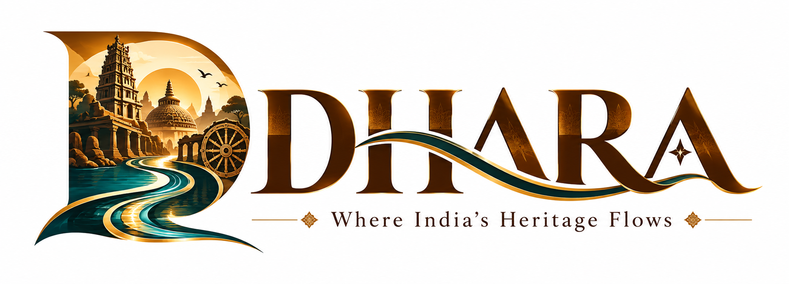
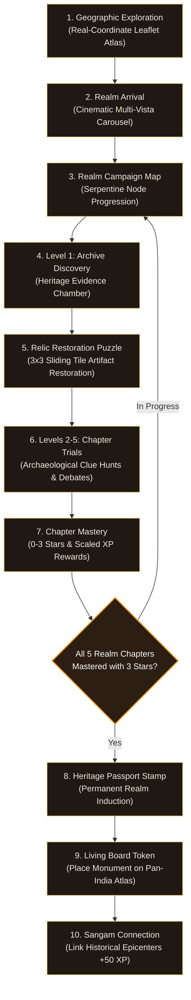
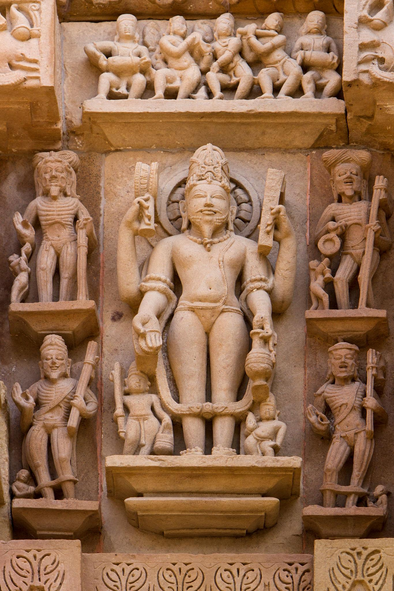
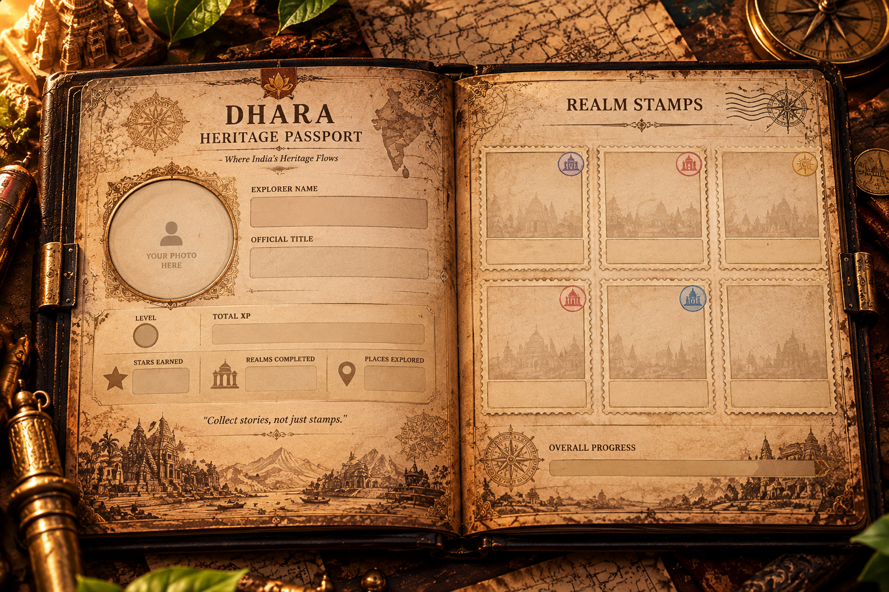
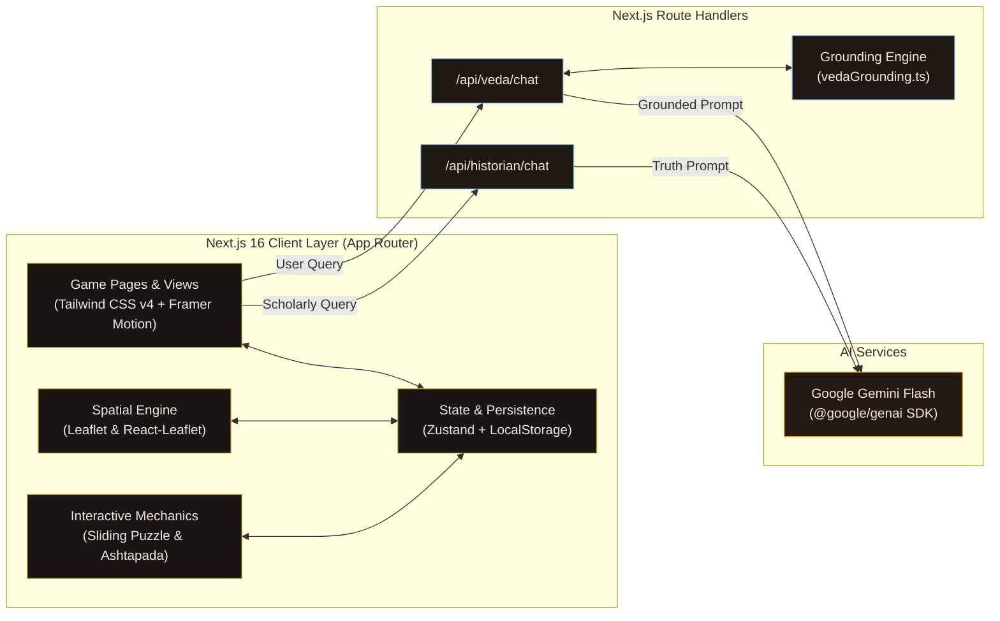

<div align="center">



# DHARA
### *Where India's Heritage Flows*

**An immersive, evidence-grounded digital heritage exploration game that brings the civilizational richness, monumental architecture, philosophy, and history of ancient India to life.**

[](https://nextjs.org/)
[](https://react.dev/)
[](https://www.typescriptlang.org/)
[](https://tailwindcss.com/)
[](https://zustand-demo.pmnd.rs/)
[](https://leafletjs.com/)
[](https://ai.google.dev/)
[](https://dhara-master.vercel.app/)

<br />

[Explore Live Realm](https://dhara-master.vercel.app/) • [GitHub Repository](https://github.com/Swaraj0160/DHARA-Master) • [Heritage Truth Layer](https://dhara-master.vercel.app/truth-layer) • [Report Issue](https://github.com/Swaraj0160/DHARA-Master/issues)

</div>

---

## 🏛️ The Problem & The DHARA Vision

Too often, cultural heritage education is trapped between two unsatisfactory extremes: **dry, static textbook summaries** that fail to inspire younger generations, or **fantasy video games** that bend historical reality beyond recognition for visual flair.

**DHARA** (*Digital Heritage Adventure & Recreation Architecture*) solves this divide. It is engineered as an authentic, interactive campaign game where players step directly into historical Indian civilizational epicenters. Rather than reading about ancient history passively, players:

1. **Examine primary archaeological evidence** in the dedicated *Heritage Evidence Chamber*.
2. **Physically reconstruct fragmented relics** via mathematically solvable artifact restoration puzzles.
3. **Engage with VEDA**, a celestial chrono-scholar AI grounded strictly in verified primary sources.
4. **Earn authentic Heritage Passport stamps** and place civilizational nodes across an interactive geographic map of India.

Every historical claim within DHARA is categorized under the **Heritage Truth Layer**: players always know whether an element is an indisputable archaeological fact, a primary source account, an architectural reconstruction, or gameplay fiction.

---

## 🎮 The DHARA Gameplay Loop

DHARA follows an intentional cycle of exploration, archaeological investigation, challenge, and civilizational connection:



### Core Progression Flow:
- **Explore:** Navigate real-world geographical coordinates across the Indian subcontinent via an antique-graded Leaflet map.
- **Discover:** Inspect genuine excavations, traveler chronicles (e.g. Megasthenes, Xuanzang), and architectural blueprints across 4 discovery phases per realm.
- **Solve:** Restore ancient carvings using interactive sliding-tile puzzles featuring authentic stone reliefs.
- **Trial:** Answer in-depth archaeological and architectural questions with Socratic hint guidance from VEDA.
- **Master:** Earn up to 3 stars per level and level up your player profile from *Seeker of Bharat* to *Eternal Sage*.
- **Connect:** Unlock city tokens upon full realm mastery and link civilizational epicenters (*Sangam Connections*) on the Living Board.

---

## 📸 Visual Showcase & Realm Experiences

<div align="center">

### The Six Civilizational Realms

| Realm | Era & Region | Historical Focus | Live Status |
| :--- | :--- | :--- | :---: |
| **Pataliputra** | *c. 300 BCE – 400 CE*<br/>Magadha (Modern Bihar) | Mauryan palisades, Kumhrar 80-pillared hall, trade guilds | **Fully Playable** |
| **Nalanda** | *c. 427 – 1197 CE*<br/>Magadha (Modern Bihar) | Dharmaganja library, palm-leaf manuscripts, scholar admission | **Fully Playable** |
| **Hampi** | *c. 1336 – 1565 CE*<br/>Vijayanagara (Karnataka) | Virupaksha, Tungabhadra gorges, Vittala musical pillars | **Fully Playable** |
| **Varanasi** | *Continuous Civilizational Epicenter*<br/>Kashi (Uttar Pradesh) | Riverfront ghats, Sarnath Dhamek Stupa, Jantar Mantar | **Fully Playable** |
| **Madurai** | *c. 300 BCE – 1700 CE*<br/>Tamil Nadu (Pandya / Nayaka) | Lotus city plan, Meenakshi Gopurams, Sangam academies | **Fully Playable** |
| **Konark** | *c. 1250 CE*<br/>Odisha (Eastern Ganga) | Surya Sun Chariot, architectural sundials, iron beam engineering | **Fully Playable** |

</div>

<br/>

<div align="center">
  <table>
    <tr>
      <td width="50%" align="center">
        
        <br/><b>Nalanda Mahavihara — Monastic University</b>
      </td>
      <td width="50%" align="center">
        
        <br/><b>Pataliputra — Imperial Mauryan Capital</b>
      </td>
    </tr>
    <tr>
      <td width="50%" align="center">
        
        <br/><b>Hampi — Vijayanagara Imperial Capital</b>
      </td>
      <td width="50%" align="center">
        
        <br/><b>Konark — The Cosmic Sun Chariot</b>
      </td>
    </tr>
  </table>
</div>

<br/>

### Key Interface Highlights

<div align="center">
  <table>
    <tr>
      <td width="33%" align="center">
        
        <br/><b>Campaign Level Map</b><br/>
        <i>Serpentine node progression with persistent stars and unlock thresholds.</i>
      </td>
      <td width="33%" align="center">
        
        <br/><b>Relic Restoration Puzzle</b><br/>
        <i>3x3 sliding tile puzzle with mathematically guaranteed solvability.</i>
      </td>
      <td width="33%" align="center">
        
        <br/><b>The Heritage Passport</b><br/>
        <i>Custom avatar, realm stamps, badges, and civilizational timeline.</i>
      </td>
    </tr>
  </table>
</div>

---

## 🛡️ The Heritage Truth Layer

> **Core DHARA Principle:**  
> **NO VERIFIED SOURCE → NO UNSUPPORTED HISTORICAL CLAIM.**

To protect cultural and historical accuracy, DHARA implements an explicit epistemological classification system. Every historical statement, puzzle explanation, and archival card presented to the player is visibly tagged:

```
┌────────────────────────────────────────────────────────────────────────┐
│                        HERITAGE TRUTH LAYER                            │
├──────────────────────┬─────────────────────────────────────────────────┤
│ 🛡️ VERIFIED          │ Undisputed consensus supported by primary       │
│                      │ archaeology (ASI reports, epigraphy, C-14 date) │
├──────────────────────┼─────────────────────────────────────────────────┤
│ 📖 SOURCE-QUALIFIED  │ Supported by primary historical chronicles or   │
│                      │ travelogues (Xuanzang, Megasthenes, Sangam texts)│
├──────────────────────┼─────────────────────────────────────────────────┤
│ 🔨 RECONSTRUCTION   │ Evidence-based scholarly extrapolation where     │
│                      │ direct physical remains are fragmented or lost  │
├──────────────────────┼─────────────────────────────────────────────────┤
│ 🪄 GAMEPLAY FICTION  │ Creative narrative framing, game mechanics,     │
│                      │ and VEDA dialogue—never masquerading as fact    │
└──────────────────────┴─────────────────────────────────────────────────┘
```

### Verified Examples from the Codebase:
- **`VERIFIED`**: The Bulandibagh excavations finding remnants of Pataliputra's monumental wooden palisades described by Megasthenes; the 24 astronomical sundial wheels of Konark.
- **`SOURCE-QUALIFIED`**: Xuanzang's description of Nalanda's nine-storey Dharmaganja library complex (*Si-Yu-Ki*); accounts of diamond and horse markets in Domingo Paes' Vijayanagara diaries.
- **`RECONSTRUCTION`**: The hypostyle 80-pillared assembly hall at Kumhrar excavated by Spooner (1912).
- **`GAMEPLAY FICTION`**: The VEDA companion persona, player XP/level systems, and puzzle abstractions.

*Explore the full interactive taxonomy in the game at [`/truth-layer`](https://dhara-master.vercel.app/truth-layer).*

---

## 🤖 VEDA — The AI Game Companion

**VEDA** (*Venerable Epigraphic Digital Assistant*) is the player's celestial chrono-scholar and companion throughout DHARA.

<div align="center">
  
  &nbsp;&nbsp;&nbsp;&nbsp;
  
  &nbsp;&nbsp;&nbsp;&nbsp;
  
  <br/>
  <i>VEDA dynamically expresses 47 distinct emotional states in response to player discoveries and dialogue.</i>
</div>

### Architectural & Guardrail Design:
- **Powered by Google Gemini:** Utilizes the official `@google/genai` SDK with an automatic multi-model fallback chain (`gemini-3.5-flash` → `gemini-3.6-flash` → `gemini-flash-latest`).
- **Local Context Grounding (`src/lib/vedaGrounding.ts`):** Instead of allowing the AI to invent facts from open-web pretraining, DHARA dynamically injects pre-vetted location facts, chapter trial explanations, and primary sources directly into the prompt as a `[VERIFIED CONTEXT]` block.
- **Strict Anti-Hallucination Policy:** If the player inquires about a historical detail not documented in the verified context, VEDA explicitly admits the gap in character (*"The chronicles I carry do not preserve that detail, seeker"*) rather than hallucinating dates or citations.
- **Anti-Cheat Guardrails:** During active puzzle trials, VEDA refuses to reveal direct answers or multiple-choice letters, providing only Socratic clues and architectural hints.
- **Topic Boundaries:** Politely deflects non-heritage queries (e.g. coding help, modern politics, personal advice) back to the realms of Bharat.
- **Daily Query Limiter:** Rate-limited to 5 queries per day (`src/store/vedaStore.ts`) to ensure respectful and intentional player interaction.

---

## 🎲 Ancient Indian Board Games

DHARA includes digital recreations of authentic historical board games from Indian antiquity, accessible at [`/games`](https://dhara-master.vercel.app/games):

### **Ashtapada (8×8 Uncheckered Race Board)**
- **Historical Heritage:** Mentioned in early Buddhist texts (*Brahmajala Sutta*, 5th century BCE) and the *Mahabharata*, Ashtapada is the ancient predecessor to *Chaturanga* (and modern chess).
- **Interactive Implementation:**
  - Played on a 64-square grid following the traditional outer-to-inner spiral trajectory.
  - Features 8 traditional cross-cut safe sanctuaries (*Castle squares*).
  - Cast traditional cowrie shell rolls (values 1–4) against an intelligent AI opponent.
  - Successfully navigating to the central sanctuary awards +150 XP and Heritage DNA bonuses.

---

## 🧩 Relic Restoration (Sliding Tile Puzzle)

Integrated directly into Level 1 of each realm's campaign progression:
- **Asset Integrity:** Restores high-resolution stone relief carvings (`public/puzzle1.jpeg`).
- **Guaranteed Solvability:** Shuffled algorithmically using 150 valid random-walk moves from the solved state, eliminating impossible mathematical parity configurations.
- **Interactive Polish:**
  - Dynamic highlight and cursor feedback only for valid movable tiles (adjacent to the empty slot).
  - Live move counter and elapsed timer.
  - **Peek** control to momentarily reference the intact relief.
  - **Check** button to count correctly positioned tiles.
  - **Socratic Hints** from VEDA guiding the player step-by-step.
  - Progression safeguards: XP (500 XP) and star rewards are validated once in the persistent store, preventing duplicate reward farming on page refresh.

---

## 🗺️ The Living Board & Cultural Constellations

Located on the World Map (`/`):
- **Real-World Cartography:** Powered by Leaflet with authentic geographical coordinates for all ancient sites.
- **Monument Tokens:** Mastering all 5 chapters of a realm with 3 stars unlocks a placeable monument token in the player's persistent inventory.
- **Sangam Connections:** Players can link placed historical epicenters (e.g. *Nalanda Mahavihara ↔ Konark Sun Temple*), tracing ancient intellectual, architectural, and pilgrimage corridors across India and earning +50 XP per connection.

---

## 🏗️ System Architecture



---

## 💻 Tech Stack & Tools

| Layer | Technologies | Purpose in DHARA |
| :--- | :--- | :--- |
| **Framework** | **Next.js 16.3.4** (Turbopack) | Modern React App Router architecture with optimized server/client rendering |
| **Core UI** | **React 19.2.8** | Component composition, hooks, and lifecycle management |
| **Language** | **TypeScript 5** | Strict type safety across game states, puzzle definitions, and APIs |
| **Styling** | **Tailwind CSS v4** | Hardware-accelerated CSS styling, responsive grid layouts, and color ramps |
| **Animation** | **Framer Motion 13.2** | Smooth layout animations, sliding puzzle transitions, and modal choreographies |
| **Cartography** | **Leaflet 1.9 & React-Leaflet 5.0** | Antique-filtered geospatial mapping with coordinate handoffs and markers |
| **3D Shaders** | **OGL 1.0.11** | Minimalist WebGL utility layer for visual shaders |
| **State Management** | **Zustand 5.0** | Persistent player profile, inventory, chapter stars, and quest progress |
| **AI / LLM** | **Google GenAI SDK (`@google/genai`)** | Powers VEDA and the AI Historian via Gemini Flash models |
| **Icons & Charts** | **Lucide React & Recharts** | Cinematic interface iconography and data visualization |
| **Hosting** | **Vercel** | Edge network deployment with automated continuous integration |

---

## 📂 Project Directory Structure

```text
DHARA-Master/
├── public/
│   ├── destinations/          # High-resolution hero and detail artwork for all 6 realms
│   ├── veda/                  # 47 emotion sprite expressions for the VEDA AI companion
│   ├── LOGO.png               # Authentic DHARA brand logo
│   ├── chapter_background.png # Cinematic campaign map backdrop
│   ├── puzzle1.jpeg           # 3x3 relic restoration puzzle source asset
│   ├── New_Passport.png       # Heritage Passport book graphic
│   └── ancient_india_map.jpg  # Antique cartographic visual
├── src/
│   ├── app/                   # Next.js App Router routes
│   │   ├── api/
│   │   │   ├── historian/chat # Grounded AI Historian API route
│   │   │   └── veda/chat      # Grounded VEDA companion API route
│   │   ├── classroom/         # Educator Dashboard (Concept preview)
│   │   ├── dashboard/         # Curator analytics overview
│   │   ├── games/             # Ancient board games (Ashtapada playable)
│   │   ├── historian/         # AI Historian scholarly Q&A interface
│   │   ├── passport/          # Heritage Passport book, stamps, and player timeline
│   │   ├── profile/           # Player level, XP rank, and badge collection
│   │   ├── quest/nalanda/     # Dedicated Nalanda narrative adventure quest
│   │   ├── realm/[id]/        # Dynamic realm campaign maps and chapter levels
│   │   ├── truth-layer/       # Interactive Heritage Truth Layer explanation
│   │   ├── layout.tsx         # Global root layout and typography
│   │   └── page.tsx           # World Map, realm selection, and Living Board
│   ├── components/
│   │   ├── game/              # Campaign maps, SlidingPuzzle, Evidence Chamber, HUD
│   │   ├── games/             # Ashtapada game engine
│   │   ├── quest/             # Nalanda manuscript hunt, scholar trials, Konark Time Lens
│   │   ├── ui/                # TruthBadge, Buttons, Cards, Glassmorphism elements
│   │   └── veda/              # Floating VEDA companion interface and speech cloud
│   ├── data/
│   │   ├── gameContent.ts     # Chapter questions, clue hunts, and realm metadata
│   │   ├── learningData.ts    # Archive discoveries and Truth Layer classifications
│   │   └── realmEntranceData.ts # Multi-vista realm entrance carousels and citations
│   ├── engine/                # SceneManager, Camera, AudioArchitecture, and Atmospheric fog
│   ├── lib/
│   │   └── vedaGrounding.ts   # Context retrieval and anti-hallucination grounding engine
│   └── store/
│       ├── gameState.ts       # Primary Zustand game progression and persistence store
│       └── vedaStore.ts       # VEDA dialogue history and emotion state store
├── .env.example               # Reference template for environment variables
├── next.config.ts             # Next.js configuration
├── package.json               # Dependencies and scripts
└── tsconfig.json              # TypeScript configuration
```

---

## 🚀 Getting Started

Follow these instructions to set up and run DHARA on your local machine.

### Prerequisites
- **Node.js**: `v18.17.0` or higher (Node 20+ recommended)
- **Package Manager**: `npm`, `pnpm`, or `yarn`
- **Git** installed on your system

### 1. Clone the Repository
```bash
git clone https://github.com/Swaraj0160/DHARA-Master.git
cd DHARA-Master
```

*(If your cloned directory contains the project root inside `DHARA-main`, navigate into `DHARA-main`)*

### 2. Install Dependencies
```bash
npm install
```

### 3. Configure Environment Variables
Create a local environment file by copying `.env.example`:
```bash
cp .env.example .env.local
```

Open `.env.local` and add your **Google Gemini API Key**:
```env
# Google Gemini API key — powers VEDA and the AI Historian
# Obtain a free key from Google AI Studio: https://aistudio.google.com/apikey
GEMINI_API_KEY=your_gemini_api_key_here
```

> **Note:** If `GEMINI_API_KEY` is omitted, the core game, maps, puzzles, and quest challenges remain **100% playable**. VEDA and the AI Historian will simply display graceful offline messages asking for the key to be awakened.

### 4. Run Development Server
```bash
npm run dev
```

Open your browser and navigate to **`http://localhost:3000`** to start your heritage journey.

### 5. Production Build & Linting
To verify production readiness:
```bash
# Type check and build with Next.js Turbopack
npm run build

# Run ESLint validation
npm run lint

# Start the compiled production build locally
npm run start
```

---

## 🔑 Environment Variables Reference

| Variable | Required? | Default | Purpose |
| :--- | :---: | :---: | :--- |
| `GEMINI_API_KEY` | Optional for core game<br/>*Required for AI chat* | *None* | Authenticates requests to the Google Gemini API for VEDA and the AI Historian. Available at [Google AI Studio](https://aistudio.google.com/apikey). |

> 🔒 **Security Notice:** Never commit `.env.local` or raw API keys to Git. In production deployments, configure environment variables exclusively via your Vercel Project Settings.

---

## 🌐 Deployment to Vercel

DHARA is pre-configured for zero-friction deployment on [Vercel](https://vercel.com):

1. **Connect Repository:** Import `Swaraj0160/DHARA-Master` into your Vercel dashboard.
2. **Framework Preset:** Vercel automatically detects Next.js.
3. **Environment Variables:** In **Project Settings → Environment Variables**, add:
   - Key: `GEMINI_API_KEY`
   - Value: `your_production_gemini_api_key`
4. **Deploy:** Any push to the `main` branch automatically triggers an optimized Turbopack build and deploys to the global edge network.

**Live Production Link:** [https://dhara-master.vercel.app](https://dhara-master.vercel.app)

---

## 🧪 Testing & Quality Assurance

DHARA enforces technical quality through automated compiler and linter verifications:

- **TypeScript Compilation:** Validated via strict TypeScript 5 configuration (`npm run build`). No implicit `any`, no untyped state mutations.
- **ESLint Linting:** Strict adherence to Next.js and React 19 standards (`npm run lint`).
- **Dynamic Leaflet SSR Safety:** Cartography components are loaded via dynamic client-side imports (`next/dynamic(..., { ssr: false })`) to eliminate `window is not defined` hydration mismatches.
- **Responsive Viewport Verification:** Manually audited across:
  - Desktop: 1920×1080, 1440×900, 1366×768
  - Tablet: 768×1024
  - Mobile: 390×844, 360×800
- **Accessibility & Motion:** Incorporates `prefers-reduced-motion` fallbacks for atmospheric fog and rotation effects, with an explicit in-game toggle in `/settings`.

---

## 🗺️ Feature Status & Project Roadmap

To maintain complete transparency regarding what is implemented versus planned:

### ✅ Fully Implemented & Live
- [x] **Universal Campaign Map:** Serpentine progression across all 5 primary realms with unlock stars.
- [x] **Nalanda Narrative Quest:** 4-stage immersive quest (Manuscript Hunt, Campus Survey, Admission Challenge, Cultural Choice).
- [x] **Heritage Evidence Chamber:** 2-column responsive layout with 4 discovery stages per realm.
- [x] **Relic Restoration Puzzle:** Solvable 3x3 sliding tile engine with movable tile highlights, move counter, and timer.
- [x] **Heritage Truth Layer:** Epistemological classification (`VERIFIED`, `QUALIFIED`, `RECONSTRUCTED`, `FICTION`) across cards, badges, and dedicated documentation.
- [x] **VEDA AI Companion:** Grounded Gemini Flash chat with 47 emotion sprites, Socratic puzzle guardrails, and daily rate limiting.
- [x] **Ancient Board Games:** Fully functional **Ashtapada** with cowrie shell dice and AI opponent.
- [x] **Heritage Passport:** Physical book design, realm stamps, badges, timeline, customizable name and avatar photo.
- [x] **Living Board:** Leaflet-based pan-India map with placeable monument tokens and Sangam connections (+50 XP).
- [x] **Local Persistence:** Resilient Zustand store saving progress, inventory, and unlock state to `localStorage`.

### 🟡 Partial / Prototype Features
- [!] **Classroom Mode (`/classroom`):** Full educator dashboard UI design with curriculum analytics; currently operates on simulated demonstration data.
- [!] **Konark Time Lens:** Interactive astronomical sundial simulator component; integrated into narrative exploration.
- [!] **AI Historian (`/historian`):** Gemini-powered scholarly Q&A; currently covers core epigraphic questions with anti-hallucination safeguards.

### 🔮 Planned Evolutions
- [ ] **Additional Board Games:** Implement *Chaupar / Pachisi* and *Moksha Patam* (Module 2).
- [ ] **Voice Narration & Speech API:** Two-way voice input/output for VEDA using the Web Speech API.
- [ ] **Multilingual Support:** Localized interfaces in Hindi, Tamil, Bengali, and Sanskrit.
- [ ] **Interactive 3D GLTF Artifacts:** Three.js / WebGL inspectable 3D scans of excavated relics.
- [ ] **Automated Test Suite:** Vitest unit test coverage and Playwright end-to-end integration testing.

---

## 🌿 Responsible Heritage & AI Ethics

DHARA is developed under a strict ethical charter:

1. **Evidentiary Honesty:** We never present conjecture as established historical fact. If a temple feature or city description is based on a traveler's account or poetic chronicle, it is explicitly classified as *Source-Qualified*.
2. **Respectful Representation:** Sacred monuments, religious iconography, and ancient philosophical schools are treated with dignity and cultural reverence.
3. **No Fabricated Citations:** The AI companion (VEDA) and AI Historian are forbidden from generating fictitious epigraphic citations, ASI report numbers, or author references.
4. **Data Privacy:** All player progress, passport stamps, and custom profile photos remain strictly stored in the user's browser `localStorage`. No private user data is harvested or tracked.

---

## 👥 Authors & Acknowledgments

- **Concept & Engineering:** **Swaraj Ingale** ([@Swaraj0160](https://github.com/Swaraj0160))
- **Institution & Team:** **Team APEX**, MIT ADT University
- **Special Acknowledgment:**
  - The **Archaeological Survey of India (ASI)** excavation reports and archives.
  - The literary legacies of classical chroniclers: Megasthenes (*Indica*), Xuanzang (*Si-Yu-Ki*), Kautilya (*Arthashastra*), and ancient Sangam poets.
  - The open-source communities behind Next.js, React, Tailwind CSS, Leaflet, Framer Motion, and Zustand.

---

## 📄 License

This project's code and original game architecture are proprietary to Swaraj Ingale and Team APEX, MIT ADT University.

*An open-source software license (such as MIT or Apache 2.0) is currently under consideration for community contributions and educational deployment.*

---

<div align="center">

**DHARA — Where India's Heritage Flows**  
*Preserving civilizational memory through interactive wonder.*

[Explore Live Prototype](https://dhara-master.vercel.app/) • [Star on GitHub](https://github.com/Swaraj0160/DHARA-Master)

</div>
